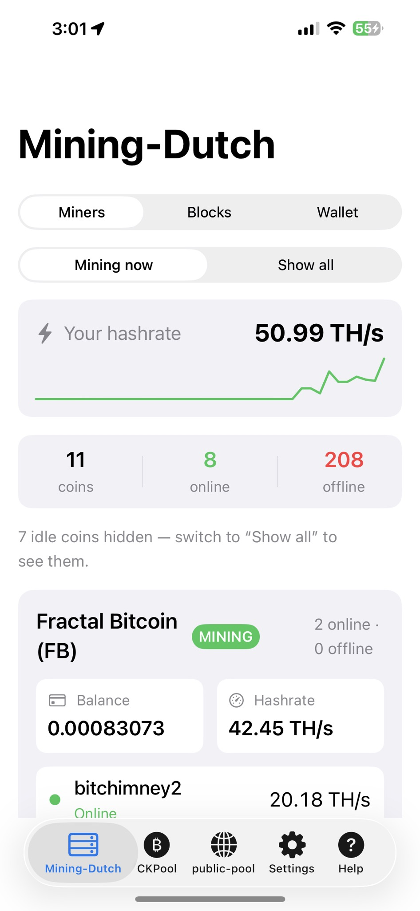
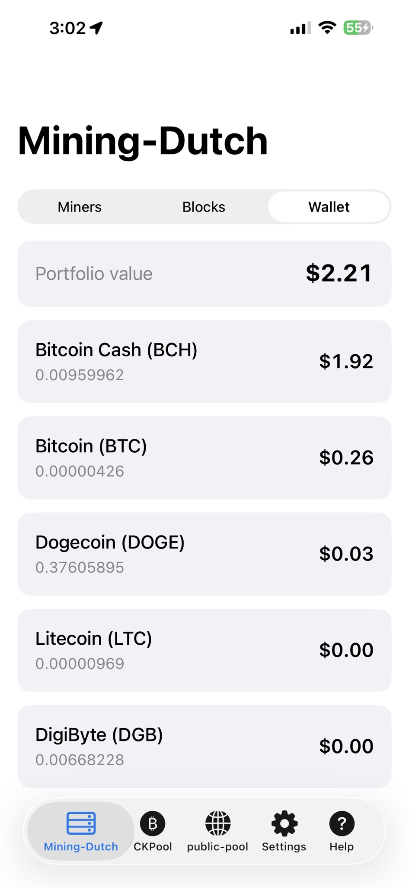
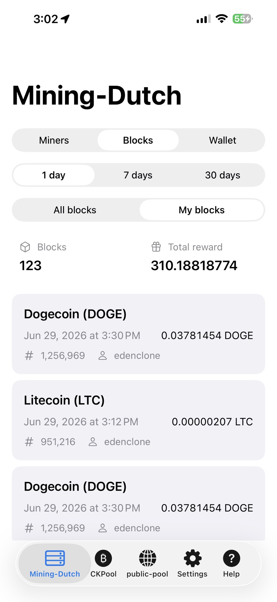

# Pool Monitor — mining pool monitor for iPhone

Watch your **solo and pool mining from your iPhone** — Bitaxe, NerdQAxe, ASICs and GPUs.
Add your BTC address or API key, and Pool Monitor shows your pool-side hashrate, workers,
best share and payouts, and **notifies you when a rig drops offline**.

No account. No ads. No tracking. Read-only — it never touches your wallet or your miners.

  
  
  

## Supported pools

| Pool | What you add | What you see |
|---|---|---|
| **Solo CKPool** | BTC address | Hashrate, workers, best share vs network difficulty, block-found alert |
| **public-pool** (public-pool.io or your own Umbrel/Start9 server*) | BTC address | Workers, best difficulty, block-found alert |
| **Mining-Dutch** | Read-only API key | Every coin you mine, rigs switching coins, daily earnings in $/BTC, payouts, blocks |
| **OCEAN*** | Payout address | Hashrate, workers, unpaid balance, next-block estimate, on-chain payouts |
| **Parasite*** | BTC address | Hashrate, workers, round rank, rounds won, Lightning status, 1 BTC win alert |
| **2Miners*** | Coin + wallet (PPLNS or Solo) | 20 coins incl. Solo BTC, payout progress, workers, payouts |

\* In version 2.0 — try it early on TestFlight: https://testflight.apple.com/join/wXKxA1YA

## Alerts

- Rig offline (with a grace period, so coin switches and Wi-Fi blips stay quiet)
- Back online, payout received, block found
- Quiet hours, per-pool and per-rig muting

## Privacy

Your addresses and keys stay on your device (keys in the iOS Keychain); settings sync only
through your own iCloud. The app talks directly to each pool's public API.

- [Privacy policy](privacy-policy.html) · [Support](support.html)
- Questions or a pool you'd like supported: **TechBitsMix@gmail.com**

---

Made by [TechBitsMix](https://github.com/shiftingeden), an indie iOS developer and home miner.
Also: **[AxeSentry](https://apps.apple.com/us/app/axesentry/id6781810919)** — monitor and control your Bitaxe swarm over local Wi-Fi.
